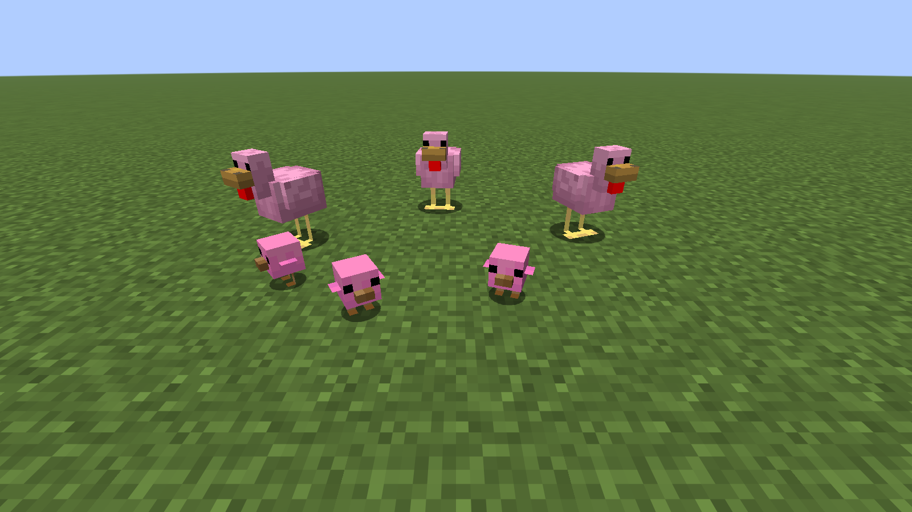
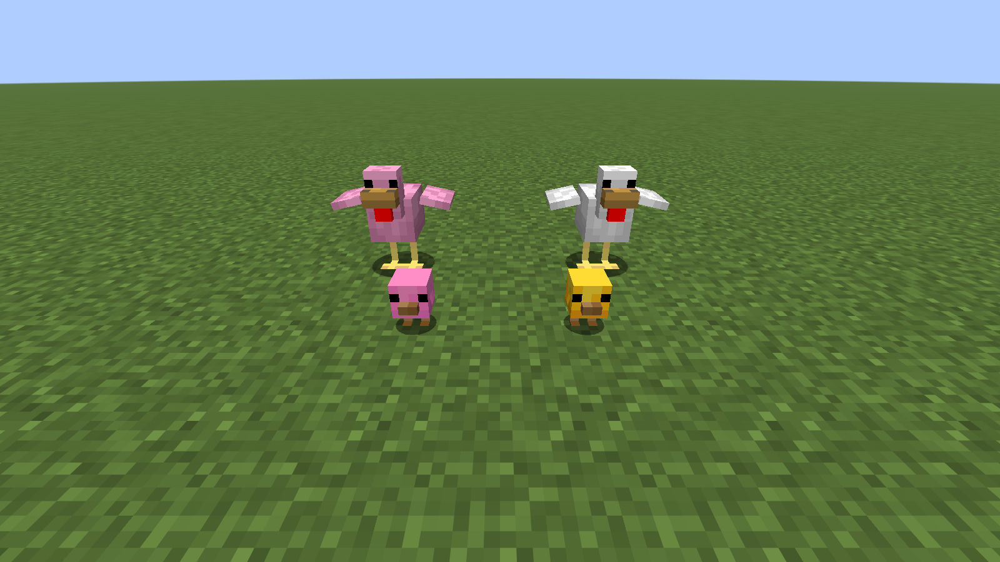
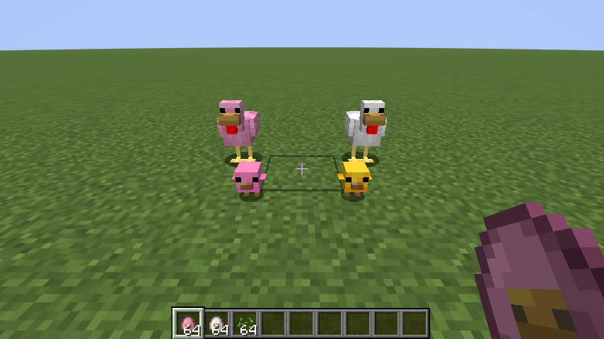

# Cipochka / Цыпочка

Мод для **Minecraft 26.3** на **Fabric**, который добавляет розовую курицу - Цыпочку (англ. *Cipochka*) и её розовых цыплят.



## Что добавляет мод

- **Цыпочка** (`cipochka:cipochka`) - отдельный моб, который полностью повторяет поведение обычной курицы: несёт яйца, ест семена, размножается, медленно падает, хлопая крыльями.
- **Розовые цыплята** - при размножении двух цыпочек рождается розовый цыплёнок, который со временем вырастает в цыпочку.
- **Яйцо призыва цыпочки** - лежит во вкладке творческого режима с яйцами призыва, сразу после куриного.
- **Естественный спавн** - цыпочки встречаются в тех же биомах, что и обычные курицы, но реже.
- Модели взрослой курицы и цыплёнка ванильные, отличается только окраска.

| Цыпочка и обычная курица | Яйцо призыва |
|---|---|
|  |  |

Призвать командой:

```
/summon cipochka:cipochka
```

## Установка

1. Установите [Fabric Loader](https://fabricmc.net/use/) `0.20.1` или новее для Minecraft 26.3.
2. Положите в папку `.minecraft/mods` [Fabric API](https://modrinth.com/mod/fabric-api) для 26.3 и `cipochka-1.0.0.jar`.
3. Запустите игру с профилем Fabric.

## Сборка из исходников

Нужна Java 25.

```
./gradlew build
```

Готовый мод появится в `build/libs/`. Запустить игру с модом для проверки: `./gradlew runClient`.

---

## English

**Cipochka** is a Fabric mod for Minecraft 26.3 that adds a pink chicken and pink chicks. It behaves exactly like a vanilla chicken (lays eggs, eats seeds, breeds) but is a separate mob with its own spawn egg. It uses the vanilla chicken and chick models with pink textures and spawns naturally, more rarely than chickens, in the same biomes.

## License

[MIT](LICENSE)
